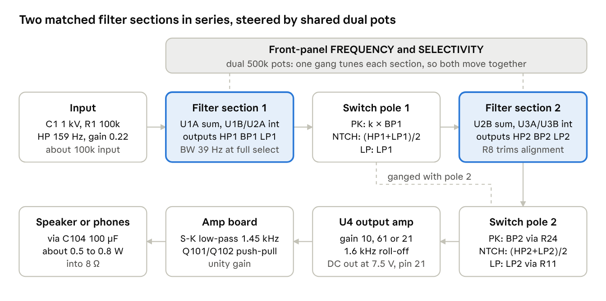

# Autek QF-1 Audio Filter: How It Works and Performance Review

The QF-1 is a tunable 4th-order active audio filter. Two identical state-variable filter sections are cascaded and tuned together, so one frequency knob and one selectivity knob give a peak (bandpass), a notch, or a low-pass response from 250 Hz to 2.5 kHz. A small power amplifier then drives a speaker or phones.

## Overview

The design sits after the receiver's audio output, so it shapes what you hear rather than what the receiver's AGC sees. Everything runs from one ~15 V supply, with the signal biased at half supply (7.5 V).

- **Main board:** input coupling, filter section 1 (U1A summer, U1B and U2A integrators), filter section 2 (U2B summer, U3A and U3B integrators), and output summing amplifier U4.
- **Front panel:** a dual 500K FREQUENCY pot, a dual 500K SELECTIVITY pot, and a 2-pole, 3-position function switch (PK, NTCH, LP). Each control has one gang per section.
- **Amp/supply board:** a 2-pole Sallen-Key low-pass driver (U101), a complementary emitter-follower output (Q101/Q102), and a full-wave rectified supply.

The function switch picks the matching output of *both* sections, so every mode is two identical 2nd-order responses in series. That doubles skirt steepness in peak and low-pass, and deepens the notch.

Signal runs left to right across the top row, then right to left across the bottom row. The shaded sections are the two identical filter cores; dashed lines are mechanical ganging, not signal.

The figures below are calculated from the component values on the original schematic. Where the original says a part is "chosen" (R3, R5, R8, R10, R11; R4, R9), I assumed the values fitted in the KiCad rebuild: 3.3 kΩ for R3, R5, R10, R11 (and R8 trimmed to match), and 4.7 kΩ for R4, R9. The results line up well with the manual's own claims: 250–2500 Hz tuning, and bandwidth from 40–50 Hz up to essentially flat.

## Input stage and single-supply bias

The input survives almost anything you can connect to it, and it trims both low frequencies and level before the filter.

- **C1 (0.01 µF, 1 kV) and R1 (100 kΩ)** feed U1A's virtual-ground summing node. The 1 kV rating lets you plug into old tube receivers whose outputs may carry high DC. With the summing node at AC ground, R1 sets the input impedance at about 100 kΩ, so it does not load a phone jack or speaker line.
- C1 and R1 also form a first-order high-pass at 1/(2π × 100 kΩ × 10 nF) ≈ **159 Hz**. That removes hum and low rumble below the speech and CW band.
- Section 1's input gain is R2/R1 = 22k/100k = **0.22 (−13 dB)**. That deliberate cut leaves headroom for speaker-level signals of several volts, which the manual expects ("no impedance matching required").

**Bias.** R21 and R20 (220 kΩ each) split B+ to a 7.5 V reference, marked Ⓐ on the schematic. C12 (22 µF) filters it with a corner of about 0.07 Hz, so 100/120 Hz ripple on this reference is down roughly 65 dB. Every op-amp's non-inverting input and both selectivity networks return to this node, which lets the whole filter run from one supply.

**Protection.** D1 (1N4001) in series with the B+ input (board pin 1) blocks a reversed supply. U1–U3 get B+ on their supply pins and ground on pin 4; the original drew these as notes only.

## The state-variable filter core

Each section is a classic state-variable (KHN-type) loop: a summing amplifier and two inverting integrators. It delivers high-pass, bandpass and low-pass outputs at once, all sharing one centre frequency and one damping.

| Role | Section 1 | Section 2 | Output node |
| --- | --- | --- | --- |
| Summer (inverting input sums input, HP feedback, LP feedback) | U1A: R1 in, R2 22k, R17 22k (∥ C9) | U2B: R6 22k in, R7 22k, R14 22k (∥ C10) | HP1 / HP2 |
| Integrator 1 (fixed) | U1B: R3, C2 18 nF | U3A: R8 10k trim, C4 18 nF | BP1 (pin 8) / BP2 (pin 18) |
| Integrator 2 (tuned) | U2A: R5 + front FREQ pot, C3 18 nF | U3B: R10 + rear FREQ pot, C5 18 nF | LP1 (pin 11) / LP2 |
| Damping input (summer +) | pins 5/6 via front SELECTIVITY | pins 13/16 via rear SELECTIVITY | — |

With τ₁ for the fixed integrator and τ₂ for the tuned one, the high-pass output of section 1 works out as:

$$
\frac{V_{HP}}{V_{in}} = -a\,\frac{s^2\tau_1\tau_2}{s^2\tau_1\tau_2 + g\,k\,\tau_2\,s + 1},\qquad V_{BP} = -\frac{V_{HP}}{s\tau_1},\qquad V_{LP} = -\frac{V_{BP}}{s\tau_2}
$$

Here a = R2/R1 is the input gain (0.22 in section 1, 1.0 in section 2). g = 1 + R2/(R1 ∥ R17) is the summer's non-inverting gain (2.22 in section 1, 3.0 in section 2). k is the fraction of the bandpass signal the selectivity network returns to the summer's + input.

This follows directly from the circuit:

- **Centre frequency** f₀ = 1 / (2π √(τ₁τ₂)). R2 = R17 and R7 = R14 make the LP feedback weight exactly 1, so no extra ratio term appears.
- **Damping** comes only from the bandpass fed back through the selectivity pot. With k = 0 there is no damping and the loop would oscillate. That is why the selectivity network always keeps R4/R9 to the bias node.
- **All three responses share f₀ and Q.** That is what makes the PK, NTCH and LP positions track one knob.

## Frequency control

The FREQUENCY pot tunes only the second integrator of each section, so f₀ varies as one over the square root of its resistance. That gives about a 10:1 range from a 0–500 kΩ pot.

Each FREQUENCY gang is wired as a rheostat: wiper to the bandpass output (pin 8 / 18), top to R5 / R10, bottom open. The tuned integrator resistance is therefore R5 + R_pot.

$$
f_0 = \frac{1}{2\pi C\sqrt{R_3\,(R_5 + R_{pot})}}
$$

- With R3 = R5 = 3.3 kΩ (as fitted) and C = 18 nF, f₀ runs from **2.68 kHz** (pot at 0 Ω) to **217 Hz** (500 kΩ). This covers the manual's "approx. 250 Hz to 2500 Hz".
- With 4.7 kΩ parts it would run only from 1.88 kHz down to 181 Hz, missing the top of the manual's range. That is why the rebuild uses 3.3 kΩ, the bottom of the original's "chosen" 3.3–6.8 kΩ range.
- Clockwise adds resistance and so lowers frequency, exactly as the manual says.

**Tuning law.** Because f₀ ∝ 1/√R, a linear-taper pot crowds the top of the range into the first part of the rotation. With linear taper, 10% rotation is already down to about 550 Hz, and half rotation to about 255 Hz. The schematic does not state the pot taper. An audio (log) taper spreads the dial far more evenly, and it is what I'd fit in a rebuild.

**Tracking.** Section 2's fixed integrator uses the 10 kΩ trimmer R8 instead of a fixed resistor. It lets you align section 2's centre to section 1's, compensating for mismatch in the dual pot and the 1%-matched capacitors. Alignment is exact at only one setting, which is why the manual suggests aligning "at the desired frequency" for use above 1.3 kHz.

## Selectivity control

The SELECTIVITY pot sets damping by choosing how much bandpass signal reaches the summer's + input. Because only the fixed integrator appears in the bandwidth formula, each section is a **constant-bandwidth** filter: turning the frequency knob moves the passband without widening or narrowing it.

Each SELECTIVITY gang is a rheostat from the bandpass output (top, pin 8 / 18) to the wiper node (pins 5+6 / 13+16). R4 or R9 returns that node to the 7.5 V bias. The fraction fed back is k = R4 / (R4 + R_sel).

$$
BW = \frac{f_0}{Q} = \frac{g\,k}{2\pi\,\tau_1},\qquad k = \frac{R_4}{R_4 + R_{sel}}
$$

- **Pot at minimum (fully CCW):** k = 1, so section 1's bandwidth is about 4.2 kHz and Q < 1. The response is essentially flat, as the manual says.
- **Pot at maximum (fully CW):** with R4 = 4.7 kΩ, k = 0.0093. With τ₁ set by R3 = 3.3 kΩ, section 1's bandwidth is then **≈ 55 Hz** and section 2's ≈ 74 Hz (its g is 3.0); cascaded, the simulation gives 37–39 Hz. The manual quotes "as small as 40–50 Hz", so R4/R9 ≈ 4.7 kΩ is close to what the factory chose. (With 4.7 kΩ in R3 the sections would be ≈ 39 and 52 Hz, and the cascade about 27 Hz.)
- **The law is strongly non-linear.** Bandwidth tracks 1/(R4 + R_sel), so most of the narrowing happens in the last part of the rotation. That explains the manual's odd-looking percentages: 10% for low-pass, 20–60% for SSB peak, 30–100% for CW.

**Consequence: Q rises with frequency.** With bandwidth held constant, Q = f₀/BW grows as you tune up. At full selectivity (section 1):

| Centre frequency | Bandwidth | Q per section |
| --- | --- | --- |
| 250 Hz | ≈ 55 Hz | ≈ 4.5 |
| 1 kHz | ≈ 55 Hz | ≈ 18 |
| 2.5 kHz | ≈ 55 Hz | ≈ 45 |

High Q near the top of the range meets the slow 1970s op-amps. A µA747 has about 1 MHz gain-bandwidth, and its excess phase pushes the effective Q of a state-variable loop higher still, towards ringing or oscillation. This is the reason behind the manual's warnings: full selectivity in peak only from 250 to 1300 Hz, under 80% selectivity at high frequencies, and possible ringing at full rotation. The TL072 in the rebuild has about 3 MHz gain-bandwidth and eases this noticeably.

## Peak, notch and low-pass outputs

Pole 1 of the function switch picks one output of section 1 and feeds it into section 2 (board pin 12 → R6). Pole 2 picks the matching output of section 2 and sends it to U4 (pin 3 → C11). Each mode is therefore two matched 2nd-order filters in series.

| Mode | Section 1 tap (pole 1) | Section 2 tap (pole 2) | What the cascade gives |
| --- | --- | --- | --- |
| PK | Pin 5: the selectivity wiper, k × BP1 | Pin 19: BP2 via R24 (10 kΩ) | Bandwidth about 0.64× one section's; skirts 12 dB/octave each side |
| NTCH | Pin 10: R16/R15 junction = (HP1 + LP1)/2 | Pin 17: R13/R12 junction = (HP2 + LP2)/2 | Two coincident nulls; depth adds; 45–50 dB in the manual's plots |
| LP | Pin 11: LP1 (U2A output) | Pin 14: LP2 via R11 | 4th-order low-pass, 24 dB/octave above the corner |

**Peak (PK).** Taking section 1's peak output from the selectivity wiper, rather than straight from BP1, is a neat trick. BP1's gain at resonance is a/(g k) and rises as k shrinks, but k × BP1 = a/g = **0.099 (−20 dB)** whatever the selectivity setting. So section 1 never clips at high Q. Section 2 has no such normalisation: its peak gain 1/(3k) rises from 0.33 to about 36. That is why the manual notes "maximum selectivity produces the highest gain at the peak". One side effect: R6 (22 kΩ) loads the wiper node in PK mode, which lowers k slightly, so section 1 is a little sharper in PK than in the other modes.

**Notch (NTCH).** HP and LP have equal passband gain and opposite phase at f₀, so their sum cancels there. The two 3.3 kΩ resistors average them, which gives the null. Notch width follows the same damping: low selectivity gives a wide, deep notch, and high selectivity a narrow one. At high selectivity, small component and tracking errors limit depth, which the manual describes as "the narrowest and shallowest notch". Peak and notch use the same f₀, so the manual's tip of finding the whistle in PK, then switching to NTCH, works. Its warning that they "may not track perfectly" comes from the PK-mode loading above.

**Low-pass (LP).** LP1 drives section 2 directly and LP2 goes out through R11. With selectivity near 10%, each section's Q is around 0.5–0.7, giving a steep, well-damped 4th-order cut. More selectivity adds a resonant hump at the corner and audible ringing, as the manual warns. Its trick of using NTCH at low frequency and low selectivity as a "very sharp" high cut works because a deep notch sits just above the passband edge, which gives an elliptic-like shape.

## Output amplifier U4

U4 (µA741, now TL071) is an AC-coupled inverting amplifier whose input resistor is whatever output section 2 is switched to. Its gain therefore changes with the mode, and those resistor values look chosen to keep the three modes at similar loudness.

- **Feedback:** R25 = 100 kΩ in parallel with C6 = 1 nF. The + input sits on the 7.5 V bias, so the output idles at 7.5 V and stays DC-coupled through R26 (100 Ω) to board pin 21. The amp board inherits this well-filtered 7.5 V as its own operating point, which saves a coupling capacitor.
- **C6 sets a low-pass pole at 1.6 kHz** (1/(2π × 100 kΩ × 1 nF)). That is a deliberate hiss cut for CW and speech, but it also takes 3 dB off a 1.6 kHz peak and about 5 dB off one at 2.5 kHz.
- **C11 (0.22 µF) with the source resistance** forms a mode-dependent high-pass: about 72 Hz in PK (R24 10 kΩ), 219 Hz in LP (R11 3.3 kΩ), and 440 Hz in NTCH (R12 ∥ R13 = 1.65 kΩ). The notch mode's higher corner thins speech a little, while the other two have no audible effect in the communications band.

| Mode | Source resistance | U4 gain (R25 / R_source) |
| --- | --- | --- |
| PK | R24 = 10 kΩ | 10 (+20 dB) |
| LP | R11 = 3.3 kΩ | ≈ 30 (+29.6 dB) |
| NTCH | R12 ∥ R13 = 1.65 kΩ | ≈ 61 (+36 dB) |

R26 isolates U4 from cable capacitance. For the QF-2, C7 couples the same node straight to board pin 2 as a line-level output; the QF-1 omits it.

## Audio power amp and supply board

The amp board is a unity-gain follower that adds a second band-limiting filter and enough current to drive a speaker. It delivers about half a watt to three-quarters of a watt into 8 Ω, which is plenty for phones and adequate for a small desk speaker.

**Sallen-Key low-pass (R101, R102, C101, C102, U101).** U101 and the two output transistors together form one unity-gain follower: the − input (pin 2) takes its feedback straight from the emitters. Around it, R101 (12 kΩ), R102 (100 kΩ), C101 (0.01 µF, to the output) and C102 (0.001 µF, to ground) make a classic unity-gain Sallen-Key low-pass.

$$
f_c = \frac{1}{2\pi\sqrt{R_{101}R_{102}C_{101}C_{102}}} \approx 1.45\ \text{kHz},\qquad Q = \frac{\sqrt{R_{101}R_{102}C_{101}C_{102}}}{C_{102}(R_{101}+R_{102})} \approx 0.98
$$

With Q near 1 there is about 1 dB of lift just below the corner, then 12 dB/octave. Combined with U4's 1.6 kHz pole, the whole unit is roughly 3 dB down at 1.5 kHz and about 14 dB down at 2.5 kHz. That is a strong "communications" voicing that suppresses hiss and splatter well. It is tighter than ideal for SSB, though, whose energy runs to about 2.7 kHz. These values were read from a hand-drawn scan, so measure the response on a built unit before trusting this corner.

**Output stage (Q101, Q102, R103–R107, D101).** U101 drives Q101's base through R103 (100 Ω). A bias string of R104 (39 Ω), D101 and R105 (1 kΩ) to ground feeds Q102's base and draws about 7 mA from the op-amp. The voltage between the two bases is about 0.6 V (D101) + 0.27 V (R104) ≈ 0.9 V. That is less than the ~1.2 V needed to keep both transistors conducting, so the stage idles in class B with a small dead zone. Feedback taken from the emitters lets the op-amp jump that gap, so crossover distortion stays low at speech frequencies.

- R106 and R107 (3.3 Ω in each collector) limit fault current and soften thermal runaway risk. They also drop some of the swing.
- C104 (100 µF) blocks the 7.5 V DC. With an 8 Ω speaker it adds a 200 Hz high-pass (400 Hz with 4 Ω), which suits communications audio; with high-impedance phones it has no effect.
- R108 (390 Ω) holds the output side of C104 at ground so plugging in phones doesn't thump. C105 (0.1–0.22 µF) bypasses RF picked up on the speaker leads.

**Supply.** Originally a centre-tapped transformer with a 2-diode full-wave rectifier (D102, D103) charged C106 (1000 µF) to about 15 V off-load. C107 and C108 (0.01 µF, 1 kV) bypassed the mains to chassis. At 0.1 A average load, ripple is about 1 V p-p (100 Hz on 50 Hz mains, a little less on 60 Hz). The filter itself barely notices it, because its reference is the separately filtered B+/2. The direct RF ground screw from the board to the chassis completes the RF bypassing.

## Gain structure and key numbers

From input jack to pin 21, the NTCH and LP passbands come out at about +10 to +16 dB. PK sits near them at mid selectivity but swings about 40 dB across the selectivity range, so you need to touch the receiver's volume control when you sharpen a peak.

| Path | Stage gains (passband or at peak) | Net to pin 21 |
| --- | --- | --- |
| LP | 0.22 (sec. 1) × 1.0 (sec. 2) × 30 (U4) | ≈ 6.7 (+16 dB) |
| NTCH | 0.11 (sec. 1 average) × 0.47 (sec. 2, incl. loading) × 61 (U4) | ≈ 3.1 (+10 dB) |
| PK, minimum selectivity | 0.099 × 0.33 × 10 | ≈ 0.33 (−10 dB) |
| PK, mid selectivity (k ≈ 0.05) | 0.099 × 6.7 × 10 | ≈ 6.6 (+16 dB) |
| PK, maximum selectivity | 0.099 × 36 × 10 | ≈ 35 (+31 dB) |

The amp board adds unity gain, minus its low-pass roll-off.

| Parameter | Value (calculated) | Manual says |
| --- | --- | --- |
| Tuning range | 217 Hz–2.68 kHz (3.3 kΩ, as fitted); 181 Hz–1.88 kHz with 4.7 kΩ | ≈ 250–2500 Hz |
| Narrowest bandwidth | ≈ 55 Hz per section, about 37–39 Hz cascaded | 40–50 Hz |
| Widest | Q < 1 per section: essentially flat | Essentially flat |
| Notch depth | Limited by matching and tracking | ≈ 45–50 dB (plots) |
| Low-pass slope | 24 dB/octave (4th order) | Steep cut-off |
| Input impedance / input high-pass | ≈ 100 kΩ / 159 Hz | Any source, no matching needed |
| Input DC withstand | 1 kV (C1) | "Virtually any source" |
| Overall high-frequency limit | ≈ 1.5 kHz (−3 dB), −14 dB at 2.5 kHz | — |
| Output power | ≈ 0.5–0.8 W into 8 Ω | Any impedance speaker or phones |
| Supply | ≈ 15 V off-load, single rail, 7.5 V internal reference | — |

The calculations assume the fitted values for the "chosen" resistors (3.3 kΩ for R3, R5, R10, R11 with R8 trimmed to match; 4.7 kΩ for R4, R9) and 18 nF capacitors; real units were trimmed individually.

## Performance rating

**Overall: 7 / 10 by today's standards, about 8.5 / 10 for its era.** The filter core is a clever, well-balanced design that really does deliver 40-ish Hz CW selectivity, a deep tunable notch and a steep low-pass from three controls. Its weak spots are tuning feel, the slow op-amps of the day, and a modest, tightly band-limited output amplifier.

| Aspect | Score /10 | Why |
| --- | --- | --- |
| CW peak selectivity | 8 | 4th-order bandpass down to about 30–40 Hz, with constant bandwidth across the dial. It rings at the narrowest settings, as any 40 Hz filter must. |
| Notch | 7 | Two cascaded tracking nulls, 45–50 dB, tunable 250 Hz–2.5 kHz. Narrow notches get shallow, and you must tune it by hand. |
| Low-pass (SSB/AM) | 7 | Steep 24 dB/octave and well damped at low selectivity. The NTCH-as-low-pass trick gives an even sharper edge. |
| Ease of use | 5 | Non-linear selectivity, a crowded frequency dial with linear pots, about 40 dB gain change in PK, and Q that changes with frequency. |
| Stability at high Q | 5 | Constant bandwidth means Q ≈ 60 near 2.5 kHz. That is marginal with 1 MHz op-amps, hence the manual's limits. Much better with TL072s. |
| Noise and headroom | 6 | The −13 dB input pad and 15 V single rail are fine for speaker-level inputs. Internal gain at high Q in section 2 can clip on strong signals. |
| Audio amplifier | 5 | About 0.5–0.8 W, class-B bias corrected by feedback. The 1.45 kHz Sallen-Key corner is aggressive for SSB. |
| Robustness | 9 | 1 kV input cap, reverse-polarity diode, RF ground screw, ordinary parts. Hard to damage from the input side; the manual warns only against back-feeding the output. |

**Strengths**

- One tuning and one selectivity knob drive two sections at once. Matched dual pots and the R8 trim keep them aligned.
- Constant bandwidth is the right behaviour for CW: the passband width you set stays put as you tune.
- Section 1's peak output is gain-normalised (k × BP), so the first stage never clips however sharp you set it.
- Mode-dependent U4 gain, set by R24, R11 and R12∥R13, keeps the three modes at similar loudness.
- A single supply and a filtered B+/2 reference make it immune to supply ripple.

**Weaknesses**

- As an audio filter it acts after the receiver's AGC. A strong signal just outside the passband still pumps the AGC and can mask a weak one inside it. Only an IF (crystal or mechanical) filter avoids that.
- Dual-pot tracking limits how far you can go: at high Q the two sections' peaks drift apart off the alignment frequency, broadening and lowering the peak.
- The peak and notch frequencies on the dial don't quite coincide, and you have to re-adjust volume when changing selectivity.
- The output stage's ~0.9 V base bias leaves a small crossover dead zone. It is tolerable on speech, though not hi-fi.

**Against alternatives.** A modern DSP audio filter does better on almost every measure: brick-wall skirts with little ringing, automatic multi-tone notching, noise reduction, and presets. The QF-1's advantages are zero latency (useful for full break-in CW), no digital artefacts, and a very natural-sounding peak. As a restored or rebuilt vintage accessory it is a capable, educational design. As a modern station's main audio filter, a DSP unit or the radio's own DSP outperforms it.

## Improvements for a rebuild

A few small changes would fix most of the weaknesses without changing the character of the design. All of them fit the KiCad boards already made.

1. **Faster op-amps (already done in the rebuild).** TL072/TL071 at 3 MHz cut the Q-enhancement problem near 2.5 kHz. For lower noise, OPA2134 or NE5532 fit the same footprint; the NE5532 wants more supply headroom, so keep B+ near 15 V.
2. **Audio-taper, close-tracking dual pots.** A log taper spreads the 1/√R frequency law evenly across the dial and makes the selectivity law much gentler. Close tracking keeps the two sections' peaks together at high Q.
3. **Widen the voicing for SSB.** Changing C101 from 10 nF to 4.7 nF moves the Sallen-Key corner from 1.45 kHz to about 2.1 kHz, with Q ≈ 0.67 for a flatter top. Changing C6 from 1 nF to 470 pF moves U4's pole from 1.6 to 3.4 kHz. Together the useful range reaches the manual's 2.5 kHz claim.
4. **Proper class-AB bias.** Add a second diode in the bias string, together with 1 Ω emitter resistors on Q101/Q102 for thermal stability, or use a Vbe multiplier. Alternatively, replace the discrete stage with a small power-amp IC such as an LM386 for simplicity.
5. **Even out the peak gain.** Taking section 2's peak from its own selectivity wiper (as section 1 does), or a gang-linked level control, would remove most of the 40 dB volume swing in PK mode.
6. **Set the trimmed parts on test.** Pick R3/R5/R10/R11 (and adjust R8) so that both sections hit the same f₀ at 1 kHz, and pick R4/R9 so that full selectivity gives about 40–50 Hz. On a scope, a tone sweep at the PK output shows both.
